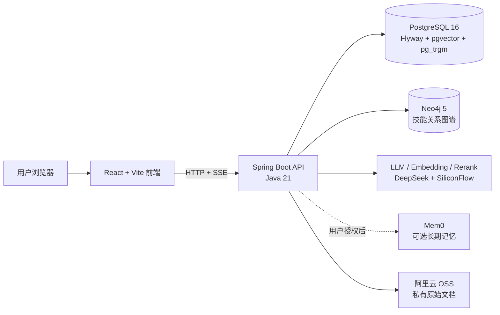
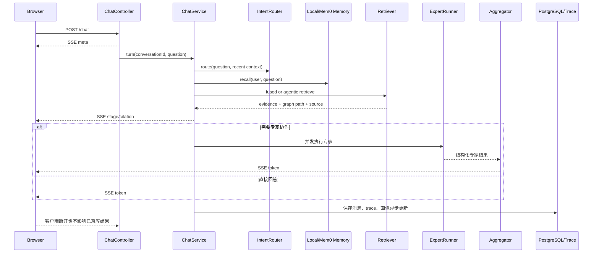

# 项目架构

## 1. 项目目标

项目面向个人求职和学习场景，将以下链路串成闭环：

```text
目标岗位 / 用户问题
        ↓
意图路由与用户上下文
        ↓
向量 + 关键词 + 图谱检索
        ↓
专家并发 / 直接回答 / 多跳检索
        ↓
结果仲裁、引用和 SSE 输出
        ↓
画像更新、学习任务、岗位推送和评测留痕
```

核心工程目标不是让 LLM 自由调用更多工具，而是让每次调用都具备明确的 Query 类型、有限候选范围、可解释证据、故障边界和可回归指标。

## 2. 组件关系



| 组件 | 职责 | 失败时的处理 |
| --- | --- | --- |
| React/Vite | 页面、SSE 消费、评测可视化、管理员操作 | 展示用户友好错误，不暴露堆栈 |
| Spring Boot | 认证、会话、Agent 编排、业务 API | 按模块超时、降级并记录 trace |
| PostgreSQL | 业务数据、会话、任务、文档分块、向量和评测结果 | 主业务依赖，未就绪时 `/readyz` 返回 503 |
| Neo4j | 技能前置关系和有限图扩展 | 熔断后返回安全空结果，主流程继续 |
| LLM 服务 | 路由、总结、专家回答、Embedding、Rerank | 超时/失败时按调用目的回退 |
| Mem0 | 可选跨会话长期记忆 | 本地 Episode 记忆兜底，不阻断聊天 |
| OSS | 知识库原始文件 | 上传失败不写入成功状态，处理失败可重试 |

## 3. 聊天请求时序



当前 SSE 事件包括：`meta`、`stage`、`clarify`、`citation`、`token`、`done`、`error`。Token 携带 `seq`，引用携带 `sid`，前端据此进行顺序拼接和证据展示。

### 3.1 当前系统详细时序图

下面的图对应当前 Java 代码的实际职责边界。聊天默认走流式回答；当
`CHAT_TOOL_LOOP_ENABLED=true` 时，直答路径会先尝试受控 JSON 工具循环，失败后回退到原有 SSE 流。

```mermaid
sequenceDiagram
    autonumber
    actor User as 用户
    participant Browser as React 前端
    participant Auth as AuthInterceptor<br/>JWT Cookie + CSRF
    participant ChatC as ChatController
    participant ChatS as ChatService
    participant Router as IntentRouter<br/>RoutingPolicy
    participant Profile as ProfileService
    participant Memory as Local Memory<br/>Episode / Mem0
    participant Retrieve as FusedRetriever<br/>AgenticRetriever
    participant PG as PostgreSQL<br/>会话 / 画像 / 任务 / Trace
    participant Neo as Neo4j<br/>技能图谱
    participant Loop as ToolCallLoop<br/>可选
    participant Registry as ToolRegistry
    participant Exec as ToolExecutor
    participant Tool as 受控业务工具
    participant LLM as LlmGateway<br/>DeepSeek / SiliconFlow
    participant Expert as ExpertRunner
    participant Agg as Aggregator
    participant Trace as TraceRecorder
    participant Async as 异步任务池

    User->>Browser: 输入问题并点击发送
    Browser->>ChatC: POST /chat<br/>conversationId + question
    ChatC->>Auth: 校验 tutor_access Cookie
    Auth-->>ChatC: 注入 userId / tenantId
    ChatC-->>Browser: SSE meta<br/>conversationId + traceId
    ChatC->>ChatS: turn(conversationId, question, events, cancellation)

    ChatS->>PG: 读取会话、最近历史和摘要
    PG-->>ChatS: history + summary
    ChatS->>Profile: snapshot(userId)
    Profile->>PG: 读取画像、技能和待确认字段
    PG-->>Profile: profile snapshot
    Profile-->>ChatS: 用户画像
    ChatS->>Memory: recall(userId, question)
    alt Mem0 已授权且熔断器关闭
        Memory->>LLM: 受限长期记忆请求
        LLM-->>Memory: 记忆结果
    else Mem0 未授权 / 超时 / 熔断
        Memory-->>ChatS: 本地 Episode 记忆兜底
    end

    ChatS->>Router: routeDecision(question, recent context)
    Router-->>ChatS: intent + scope + confidence + reasonCodes
    ChatS->>Router: routingPolicy.plan(decision, question)
    Router-->>ChatS: execution plan<br/>facets / skipRetrieval / experts

    alt 越界或无需检索
        ChatS-->>Browser: SSE stage(out_of_scope / direct)
    else 需要证据
        ChatS-->>Browser: SSE stage(retrieving)
        ChatS->>Retrieve: retrieve(question, topK, traceId, scope)
        Retrieve->>LLM: query embedding
        LLM-->>Retrieve: vector query embedding
        Retrieve->>PG: pgvector Top20
        PG-->>Retrieve: dense candidates
        Retrieve->>PG: pg_trgm sparse search
        PG-->>Retrieve: sparse candidates
        Retrieve->>Neo: 白名单关系一跳扩展
        Neo-->>Retrieve: graph neighbors
        Retrieve->>Retrieve: RRF 融合、去重、图分数衰减
        opt 资源推荐或配置要求重排
            Retrieve->>LLM: rerank candidate pool
            LLM-->>Retrieve: rerank scores
        end
        Retrieve-->>ChatS: TopK Evidence<br/>source + graph path + citation ids
        ChatS-->>Browser: SSE citation<br/>证据列表和来源状态
    end

    alt 需要专家协作
        ChatS->>Expert: run(experts, briefing, traceId, cancellation)
        par 简历专家
            Expert->>LLM: Purpose.EXPERT structured JSON
            LLM-->>Expert: resume advice + citations
        and 学习规划专家
            Expert->>LLM: Purpose.EXPERT structured JSON
            LLM-->>Expert: weekly plan + citations
        and 面试专家
            Expert->>LLM: Purpose.EXPERT structured JSON
            LLM-->>Expert: questions + citations
        end
        Expert->>Expert: schema / size / confidence / citation validation
        Expert-->>ChatS: valid expert outputs<br/>failed experts treated as absent
        ChatS->>Agg: aggregate(question, evidence, expert outputs)
        Agg->>LLM: Purpose.CHAT aggregation
        LLM-->>Agg: answer stream
        Agg-->>Browser: SSE stage + token
    else 直接回答
        ChatS->>ChatS: assemble prompt<br/>profile + evidence + history + memory
        alt CHAT_TOOL_LOOP_ENABLED=true
            ChatS->>Loop: run(Purpose.CHAT, messages, context)
            Loop->>LLM: chatJson(strict JSON protocol)
            LLM-->>Loop: tool_call or final
            loop 最多 3 步
                alt type=tool_call
                    Loop->>Registry: resolve(tool name)
                    Registry-->>Loop: ToolRegistration + input schema
                    Loop->>Exec: executeJson(tool, arguments, context)
                    Exec->>Registry: permission + schema + side-effect check
                    Registry-->>Exec: allowed / rejected
                    Exec->>PG: claim idempotency key<br/>L1/L2 only
                    Exec->>Tool: execute with timeout
                    Tool-->>Exec: result or failure
                    Exec->>PG: tool_calls audit<br/>args digest + status + duration
                    Exec-->>Loop: bounded tool result
                    Loop->>LLM: tool result as untrusted data
                    LLM-->>Loop: next tool_call or final
                else type=final
                    Loop-->>ChatS: final answer
                end
            end
            alt 工具循环失败 / 步数超限 / 输出非法
                Loop-->>ChatS: error
                ChatS->>LLM: 回退到普通 chatStream
            end
        else 默认流式直答
            ChatS->>LLM: chatStream(Purpose.CHAT, messages)
            LLM-->>ChatS: streaming tokens
        end
        ChatS-->>Browser: SSE token(seq, text)
    end

    ChatS->>ChatS: citation guard<br/>解析 [S#] 并校验来源
    ChatS->>PG: append assistant message<br/>citations + citation_status + trace_id
    ChatS-->>Browser: SSE done(messageId, citationStatus)

    par 请求完成后的异步工作
        ChatS->>Async: postTurnTasks.submit
        Async->>Profile: updateFromMessage(userId, question, answer)
        Profile->>PG: 写入画像变更事件
        Async->>Memory: episode summarization / outbox sync
        Memory->>PG: 保存摘要、租约和 outbox
        ChatS->>Trace: record turn trace
        Trace->>PG: 异步写入 turn_traces
        ChatS->>PG: citation verification job
    end

    alt 用户中途断开 SSE
        Browser--xChatC: disconnect
        ChatC->>ChatS: cancellation.cancel()
        ChatS->>LLM: 关闭底层流 / 中断专家任务
        ChatS->>PG: 已完成部分仍按边界落库
    end
```

### 3.2 工具执行安全边界

```mermaid
sequenceDiagram
    participant Model as LLM
    participant Loop as ToolCallLoop
    participant Registry as ToolRegistry
    participant Executor as ToolExecutor
    participant Idempotency as tool_idempotency
    participant Handler as Tool Handler
    participant Audit as tool_calls

    Model->>Loop: {type: tool_call, tool, arguments}
    Loop->>Registry: 查找工具并反序列化参数
    Registry-->>Loop: schema + allowedAgents + timeout + L0/L1/L2
    Loop->>Executor: executeJson()
    Executor->>Executor: 校验 agent 权限
    Executor->>Executor: Bean Validation 参数校验
    Executor->>Executor: L2 用户确认校验
    Executor->>Idempotency: 回收过期 RUNNING 记录
    Executor->>Idempotency: claim(user, tool, key)
    alt 已有 COMPLETED 结果
        Idempotency-->>Executor: 返回缓存结果
    else 已被其他请求占用
        Idempotency-->>Executor: 拒绝并发执行
    else 首次执行
        Idempotency-->>Executor: claim success
        Executor->>Handler: 在契约 timeout 内执行
        alt 执行成功
            Handler-->>Executor: result
            Executor->>Idempotency: 保存 COMPLETED + JSON result
            Executor->>Audit: success + args_digest + duration
        else 超时 / 异常 / 取消
            Handler-->>Executor: failure
            Executor->>Idempotency: release RUNNING
            Executor->>Audit: failed / timeout + args_digest
        end
    end
    Executor-->>Loop: 有界工具结果或安全错误
    Loop->>Model: 结果标记为不可信数据
```

## 4. 检索架构

检索在本系统里是**辅料，不是主料**。系统的核心是用户模型（画像 / 记忆 / 证据），检索负责为回答提供可溯源的材料：简历与上传文档、用户画像、记忆提取，以及公开的知识种子。因此：

- 问候、闲聊、越界轮次直接跳过检索（`skipRetrieval`），检索不是必经路径；
- 回答必须用 `[S#]` 标注材料来源，由引用校验保证每个标号都有对应证据；
- 检索排序不追求「答得像个知识库」，而是「答得贴合这个人」——画像当前只渗透到上下文拼装层，尚未参与重排（见 4.4 的边界说明）。

### 4.1 查询类型

对话意图使用有限枚举：`resume`、`interview`、`planning`、`mixed`、`chat`、`out_of_scope`。

检索器还会根据 Query 内容判断是否属于资源推荐或学习路径问题：

- 资源推荐：向量、pg_trgm、图扩展，必要时二阶段重排；
- 学习路径：启用 Agentic 多跳检索；
- 普通问题：优先单跳检索；
- 越界问题：跳过不必要的 embedding 和专家调用。

### 4.2 混合检索

```text
Query
 ├─ pgvector：向量 Top20
 ├─ pg_trgm：稀疏 Top20
 └─ Neo4j：向量前10节点的一跳扩展
       ├─ 关系白名单
       ├─ 每源节点配额
       └─ 总候选数上限
          ↓
      RRF 融合 + 图扩展衰减 + 候选去重
          ↓
      资源推荐 Query 才进入 Rerank
          ↓
      TopK Evidence
```

当前实现的关键限制包括：

- RRF `K=10`；
- 向量候选上限 20；
- 仅对向量前 10 个节点做图扩展；
- 每个源节点最多扩展 6 个邻居，所有源节点合计最多扩展 40 个邻居；
- 图扩展贡献使用 `ALPHA=0.85`；
- 稀疏通道使用 `BETA=0.3`；
- 资源 Query 对非资源节点的扩展贡献进行抑制。

这些数值是当前实现的实验性配置，应通过评测集重新校准，不代表所有数据规模下的最优值。

### 4.3 受控多跳检索

多跳检索最多 3 跳。每跳会：

1. 使用当前 Query 走融合检索；
2. 按节点 ID 去重并累计证据；
3. 对第 2、3 跳应用分数衰减；
4. 由 LLM 判断证据是否充分，必要时生成下一跳 Query；
5. LLM 输出无效或失败时使用固定 Query 收窄策略。

LLM 不能直接执行任意图查询。跳数、候选规模、关系范围和最终 TopK 都由服务端控制。

### 4.4 证据来源标注

每条 `Evidence` 带 `sourceKind`：`self`（用户自有材料）/ `reference`（公开参考资料）。判定复用图谱既有的所有权模型，不新增分类维度：

| 来源 | 判定 | 结果 |
| --- | --- | --- |
| `kg_chunks` 公开种子 | `visibility='public'` | `reference` |
| `kg_chunks` 归户切片 | `owner_user_id = 检索 scope.userId` | `self` |
| `knowledge_documents` 上传文档 | `created_by = scope.userId` | `self` |

传播路径：检索（`VectorStore` 带出 `owner_user_id`）→ 融合与合并（任一自有即自有；无命中回捞时宁按参考漏标）→ 提示词（自有证据标〔自有〕）→ SSE `citation` 事件与引用 JSON（落库，历史会话可恢复徽标）→ 前端正文标号配色与「你的材料 / 参考资料」徽标。

边界：画像与记忆目前是独立上下文分区（`ProfileSection` / `FactsSection`），**不进 `Evidence`**，因此不会被标注为 `self`；它们属于「懂你」的另一条线，见第 5 节。

### 4.5 画像感知重排

检索内核（融合/多跳/评测链路）与画像完全解耦；个性化只发生在 chat 检索阶段的**排序裁决**，不改写打分：

- chat 检索多取一个溢出候选池（topK+7），用 L3 画像做一次**稳定重排**后裁回 topK——与画像同向的证据在检索原分接近时存活，语义不相关的内容不会被画像顶进来；
- 画像信号仅两个：`target_position`（强信号，命中任一词元 +0.20）与 `skills`（弱信号，confidence≥0.5 者每命中 +0.06×confidence，总封顶 +0.15）；单条证据总增幅封顶 ×1.25；
- 匹配是纯文本判定：ASCII 词元按词边界（"go" 不会命中 "google"），CJK 按子串；加成相同的候选保持检索原序；
- 门禁 `RETRIEVAL_PERSONALIZE_ENABLED`（默认关闭，沿用「离线评测确认收益后才启用」约定）；trace 记 `personalize_applied` / `personalize_boosted_count` 用于收益归因。
- **2026-10-29 离线评测结论：收益未证实，保持默认关闭。** 四臂 A/B（280 条，A=基线 top5 池 /
  B=溢出池空画像 / C=溢出池+对齐画像 / D=溢出池+错位画像；对齐画像取自查询词元，模拟"用户问自己熟悉的领域"）：
  B vs A 证明池效应≈0（Recall@5 均 62.6%）；C vs B 为**纯画像负效应**（62.6%→60.2%，top5 顺序改变的 73 条里 10 升 16 降，
  `job_requirement` 切片退化最重 62.2%→54.8%）。机制解释：查询词元命中的干扰切片与 gold 一样多，
  加成把词汇相似但语义更远的候选拱了上去，而 RRF 原排序本已调优；×1.25 封顶只防灾难、不防慢性退化。
  错位画像（D）同样低于基线，即"无关画像不加分也不免伤"。复评入口：`evals/run_personalize_eval.mjs`。

### 4.6 多跳前置切片诊断与 facet/图加权修复（2026-10-30）

四臂评测暴露 `multi_hop_prereq` 切片 Recall@5 仅 37.2%（天花板 97.7%，非指标结构性低估）。逐条归因
（`/internal/retrieve` 新增 facets/graph_relations/telemetry 输出，图通道遥测随响应返回）后确认三层机制
缺陷叠加 gold 噪声，随后按机制修复：

| 缺陷 | 修复 |
|---|---|
| facet 措辞缺口：「先会/先懂/先补/提前看/完全不懂/从哪儿开始」不触发 LEARNING，图扩展没开 | `RetrievalFacetRules.LEARNING` 扩充口语前置问法 |
| CONCEPT 过拦：「正则化技术是啥？零基础想学…」被「是啥」整体拦截成空 facet | CONCEPT 仅在无学习/岗位信号时抑制（混合意图让位） |
| 资源问法漏判：「有啥好书推荐/实战项目可以练手」落进 LEARNING，图加权挤掉资源 gold | `RESOURCE_SUBJECT` 补全资料问法（资料主体单给 resource，规则 3） |
| 图候选 RRF 打分不足：前置 chunk 与查询词面无关，`alpha/(k+rank)≈0.06` 压不过双通道话题切片（0.09+） | LEARNING facet 下 `PREREQUISITE` 入边权重 1.0→2.0——边类型本身编码意图，属机制证据而非词面启发 |

全量 280 条复测（fused 臂，评测结果 `evals/results/fused_facet_fix_2026-10-30.json`）：
**整体 Recall@5 62.6%→70.4%、Hit@5 89.3%→96.1%、MRR 0.707→0.779**；`multi_hop_prereq` 切片
Recall@5 37.2%→66.4%、Hit@5 75%→100%（零命中清零）；`resource_rec` 与基线持平（97.5% Hit），
`job_requirement` -1pp（名次级，无新增零命中），`single_hop` -1.7pp（1 条）。其余发现：

- `retrieve` 工具超时可配置（`tutor.agent.tool.retrieve-timeout-seconds`，默认 30s 不变）——judge 驱动
  的多跳在慢推理模型下会超 30s 顶，评测路径（ToolExecutor）因此失真；chat 主链路直调检索不受此约束；
- 逐条 gold 复核推翻了部分"gold 噪声"初判：q217/q274（数学题挂 DSA/python gold）与图数据一致，
  是有效标注；真正无解的是 gold 与图都不覆盖的少数案例（如 Transformer 无已知前置）；
- channel-floor（各通道保底 1 名额）对图候选无增益：保底名额被"同时也是 dense 命中"的节点占掉，
  保持默认关闭。

### 4.7 两跳前置扩展与策略选择抑制（2026-10-31）

4.6 之后 `multi_hop_prereq` 已到 66.4%、零命中清零，但缺口性质没查清。按 gold 规模拆解发现：
**top5 里平均只有 2.15 个名额被 gold 占用，还空着 2.85 个**——连 gold 只有 2 个的案例也只命中 1.41 个。
说明不是"位置不够"，而是 gold 压根没进 top5。

用 topK=20 的探针区分召回与排序：Recall@20 仅 83.2%，**19.9% 的 gold 连前 20 都进不来**，且缺失的
全是 `python-basics`(7x)、`calculus`、`gradient-descent`、`activation-functions` 这类最底层基础。
这些技能在 `kg_chunks` 里都有切片（495 节点 / 495 chunks），所以不是数据缺失。

根因：**评测集 gold 标的是前置关系的传递闭包，而图扩展只走单跳**。「学 PyTorch 前要会什么」的 gold
含 `neural-networks`（直接前置）和 `deep-learning-basics`（前置的前置）。Cypher 验证两跳闭包与 gold
完全一致（`pytorch` → {deep-learning-basics, neural-networks, python-basics}；`data-augmentation` →
{calculus, deep-learning-basics, gradient-descent, machine-learning-fundamentals}），平均 3.04 个
邻居、最大 8 个，规模可控。

| 改动 | 说明 |
|---|---|
| `GraphExpansionPolicy.Rule` 增加 `maxHops`（1 或 2，硬编码安全边界） | 只有传递语义的关系才允许走第二跳；`TEACHES`/`REQUIRES` 保持单跳 |
| LEARNING 下 `PREREQUISITE` 入边改为 `*1..2` 变长路径 | 一次查到两跳闭包，同邻居多路径只保留最高分那条，不重复占 `perSource` 名额 |
| 第二跳置信度 × 0.85 | 见下 |
| `STRATEGY_CHOICE` 抑制前置扩展 | 「先刷 easy 还是直接 hard」是做法问题，不是「要学什么」 |

**0.85 这个折扣是算出来的**：第二跳得分 = `alpha × weight × dampen / (rrfK + seedRank)`，要进 top5
必须高于 dense 第 5 名的 `1/(rrfK+5)=0.0667`。dampen=0.6 时只有 seedRank≤5 才够——实测第二跳恰好停在
9-12 名（Recall@5 反而 67.0%→66.2%）；0.85 可覆盖 seedRank≤10，同时仍低于第一跳（1.0），保持
「直接前置优先于传递前置」。

**策略选择抑制**来自 q010 坏例：「LeetCode 刷题是先刷 easy 还是直接 hard?」gold 是 `leetcode-practice`，
但「刷题」触发 LEARNING，前置扩展把 DSA / python-basics 拱上来，正主被挤出 top5。判据只认**动作类**
动词（刷/做/背/练/准备/投/写）+「还是/或」，**不认「学」与「看」**——「我该先学机器学习还是直接上手
LangChain」「先看线代还是微积分」问的是学习顺序，两个选项是不同的知识实体，前置依赖恰恰就是答案。
（收窄前曾在人工标注语料上误伤一条，40/40 掉到 39/40，已修正并加回归用例。）

全量 280 条复测（`evals/results/fused_two_hop_2026-10-31.json`）：

| 切片 | 4.6 之后 | 本次 | Δ |
|---|---|---|---|
| 整体 | 70.4% / Hit 96.1% / MRR 0.779 | **71.2% / 95.7% / 0.785** | +0.8pp |
| multi_hop_prereq | 66.4% / Hit 100% / MRR 0.768 | **69.4% / 98.75% / 0.786** | **+3.0pp** |
| single_hop_skill | 93.3% | 93.3% | 持平（q010 已修回） |
| resource_rec | 63.9% / 97.5% | 63.9% / 97.5% | 持平 |
| job_requirement | 61.2% / 91.7% | 61.2% / 91.7% | 持平 |

`multi_hop` 的 Recall@20 从 83.2%→**91.8%**，完全未召回的 gold 从 19.9%→10.7%——两跳把「不可达」
变成了「可达」，这是结构性改善而非调参收益。

边界与遗留：

- 唯一回归是 `multi_hop` 的 Hit@5 100%→98.75%（1 条 q215）。核对判定为**标注口径分歧**：用户问
  「词向量零基础得先补啥」，返回线代/微积分/DL 基础其实贴合问题，但 gold 只标到 NLP/RNN。
  不为它改代码（否则就是对评测集过拟合）。
- 剩余 10.7% 完全未召回的 gold 仍需图数据或标注口径层面解决，不是检索算法能补的。
- 两跳只作用于 LEARNING facet 的 `PREREQUISITE`；chat 主链路与评测链路共用同一套策略。

### 4.8 岗位查询的答案形态转换（2026-10-31）

4.7 之后四个切片里 `job_requirement` 最弱（61.2%）。这一轮没有继续调排序，而是先问「这个切片里被检索到的东西，
到底该不该出现在答案里」，于是得到一个结构性问题：

- **gold 只由两类节点构成**：666 条 `skill:*` + 345 条 `res:*`，**没有任何一条 gold 是岗位节点**；
- 而 `job_requirement` 的 300 个 top5 槽位里，有 **85 个（28.3%）被岗位节点占掉**——不是排位不够，是答案位被
  「索引」而不是「内容」占了；
- 纯向量通道下这个切片只有 **1.9%**：岗位 JD 的切片文本与「这个岗位要会什么」在语义上几乎重合，
  dense 检索必然把 JD 本身排在最前，而它永远不可能是正确答案。

根因是通道语义而非检索质量：**岗位节点是需求侧的索引，不是可作答的内容**。它正确的角色是被翻译成
它 `REQUIRES` 的技能集合。图谱里这份数据是完整的（202 个岗位、1146 条 REQUIRES 边，每个岗位 4-6 条技能，
19 个 4 条 / 28 个 5 条 / 155 个 6 条）。

| 改动 | 说明 |
|---|---|
| `JobSkillQueryClassifier` 补齐同义问法 | 「要求什么/具备哪些/得懂哪些/要啥」单列一档 0.72，首版漏判 7/60 |
| 同上：新增岗位语境门禁 | 只有需求动词、没有角色名词的问法（「微调 BERT 需要改哪些层」）按 NEGATIVE 同等降权 ×0.35 |
| `JobSkillAnswerPolicy` 改为「替换全部岗位槽位」 | 原来只在**融合排序第 1 名是岗位节点**时提升，实际只有 12/60 命中；现在取排序最靠前的岗位节点，把它 `REQUIRES` 的技能提到最前，其余岗位节点一并让位 |
| `RetrievalCandidatePipeline` 定向补一次 REQUIRES 查询 | 通用扩展起点只取 dense/sparse 前 N 名与别名种子，命中 topK 的岗位节点未必在其中（实测只有 34/60 能靠通用扩展拿到边）；改为对命中的岗位节点做定向一跳（最多 2 个节点），并回捞缺失切片文本 |
| `GraphExpansionPolicy.jobRequirementLookup()` | 把「用哪条关系回答」收进策略类，仍受 `ALLOWED_RELATIONS` 白名单约束，不读任何 LLM 输出 |

**防过拟合的三条约束**（这一点必须写清楚，因为 gold 的构造方式本身来自图谱）：

1. 只在查询被判定为技能寻求型时触发，岗位介绍/职位推荐类查询不受影响；
2. 提升数量上限 `min(6, topK-1)`——永远给独立召回留一个名额。实测「全占满」时 Recall 相同但 Hit 从 97.5%
   掉到 96.4%，说明留一个独立证据位是有价值的；
3. 已在 topK 内的技能不重复提升，保留多通道共同认可的证据排序。

全量 280 条复测（`evals/results/eval_2026-10-31T12-30-28-369Z.json`）：

| 切片 | 4.7 之后 | 本次 | Δ |
|---|---|---|---|
| 整体 | 71.2% / Hit 95.7% / MRR 0.785 | **76.3% / 97.5% / 0.827** | **+5.1pp** |
| job_requirement | 61.2% / 91.7% / 0.770 | **85.0% / 100% / 0.989** | **+23.8pp** |
| single_hop_skill | 93.3% | 93.3% | 持平 |
| resource_rec | 63.9% | 63.9% | 持平 |
| multi_hop_prereq | 69.4% | 69.4% | 持平 |

四方对比同步刷新：`vector_only 44.6% → fused 76.3% → fused_rerank 79.4% → agentic 96.0%`（Hit 63.6/97.5/97.9/96.0，
fused P50 229ms）。`fused_rerank` 的提升来自 resource 切片（63.9→74.8%），与本次改动无关。

边界与遗留：

- 85% 已接近机制上限：60 条里只有 41 条的 gold 能被**单个**岗位的 REQUIRES 完全覆盖，平均覆盖率 91.8%。
  剩余缺口是「gold 跨多个岗位」或「gold 含岗位要求之外的技能」，不是靠调检索能补的。
- agentic 模式（LLM judge）只抽样 50 条，未覆盖 job 切片，因此不参与对比。
- 路由准确率（63.3%）是既有短板，与本次改动无关，单独列入下一步。

## 5. 记忆、文档和业务闭环

### 记忆

- 本地 Episode 记忆：默认可用，保存可控的会话摘要和情节信息；
- 语义事实层（user_facts，V66）：从已脱敏的 Episode 源窗口抽取的原子短事实（目标/偏好/技能/约束/背景），
  事实不可变追加，冲突按确定性规则消解（同类目 + bigram 阈值：≥0.88 视为重复跳过、≥0.60 新事实使旧事实软失效），
  参考 mem0 的 ADD/UPDATE 与 Graphiti 的事实失效思想；每条事实过准入边界（长度/注入标记/零 PII 残留）与记忆代际 fencing；
- 召回排序：情景记忆按相关度 + recency 指数衰减（τ=`memory.recall.recency-decay-days`）+ 未决事项加权；
  事实按问题包含度 + 置信度 + recency 排序；两者均失败降级为空列表；
- 记忆透明化：`/chat` SSE 新增 `memories` 事件，透出本轮实际进入提示词的记忆（事实+情景）；
  新会话开场通过 `/memories/open-items` 主动提醒上次未完成事项；
- 记忆评测：`evals/run_memory_eval.mjs` 打真实 `/internal/memory-recall` 管线，
  覆盖事实命中、superseded 泄漏率（阈值 0）、时序正确性与无关注入；
- 重要性门控：Episode 抽取前做确定性显著信号检查（目标/偏好/约束/纠正/掌握度），闲聊窗口不烧 LLM；
  窗口未满时被跳过的窗口不推进水位线，后续累积后自动重试；窗口满 30 条仍无信号则整窗跳过并推进水位线，
  避免长闲聊把该会话的记忆永久卡死，可用 `MEMORY_EPISODE_IMPORTANCE_GATE_ENABLED` 关闭；
- Mem0：默认关闭，必须用户授权，调用超时或熔断后回退本地；语义事实仅存本地，不进 Mem0 outbox；
- 写入与删除：通过本地事务 Outbox、记忆代际和带 fencing token 的租约执行；worker 崩溃后任务可被重新认领；
- 单条删除：已知远端 UUID 时精确删除，未知 UUID 时按用户范围发现 `metadata.memory_id` 后删除，发现尚未完成则退避重试；
- 删除记忆：先删除本地权威记录并用墓碑阻止旧远端结果回流，远端删除失败通过状态接口和审计日志暴露。

### 文档

```text
管理员上传
   ↓
OSS 保存原文件 + PostgreSQL 保存元数据
   ↓
异步解析 PDF / DOCX / TXT / Markdown
   ↓
结构感知切分（目标 1500、最大 2300 tokens；同结构约 200 tokens overlap；无 token 预算时才回退到字符上限）
   ↓
Embedding
   ↓
knowledge_document_chunks
   ↓
状态 indexed 后加入向量检索
```

原文件不进入 PostgreSQL；PostgreSQL 只保存元数据、处理状态、分块和 embedding。

### 岗位到学习任务

岗位要求与用户画像先进行技能对齐，再结合图谱前置关系生成任务。任务需要绑定学习目标和完成证据，例如代码、测验或面试验证，并通过幂等约束避免重复推送。
